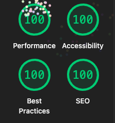
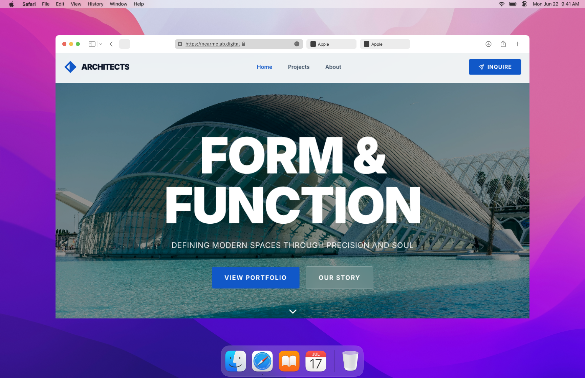

# 🌆 3dinterior



**Free Astro theme built for architects and design studios.** Blazing-fast performance meets stunning minimalist design.

<p align="center">
  <a href="https://astro.build">
    
  </a>
  <a href="https://tailwindcss.com">
    
  </a>
  <a href="LICENSE">
    
  </a>
</p>

## 📌 Key Features

- ✅ **100/100 Lighthouse score** - Optimized for performance
- ✅ **Portfolio-first design** - Showcase projects beautifully
- ✅ **Mobile-responsive** - Target different devices
- ✅ **Zero JavaScript** (optional) - Fast by default
- ✅ **Easy customization** - Tailwind + clean components



---

## 🚀 Quick Start
```bash
# Clone and install
git clone https://github.com/nearmelab/3dinterior.git
cd 3dinterior
pnpm install

# Start dev server
pnpm dev
```

Visit `localhost:4321` - that's it! 🧑‍🚀

## Building for a subfolder

Use Node.js 22.12 or newer. The build defaults to the site root:

```bash
npm run build
```

To serve the site at `https://example.com/designer-preview/`, pass Astro's base flag:

```bash
npm run build -- --base=/designer-preview/
```

With the current Cloudflare adapter, the static files are written to
`dist/client/designer-preview/`. Copy that directory's contents into the
`designer-preview` folder on your host. Root builds write the site to `dist/client/`.
The base flag controls the URL path, not the domain.

For local development with the same path:

```bash
npm run dev -- --base=/designer-preview/
```

Open `/designer-preview/` on the local dev server. Omit `--base` to return to `/`.

When adding pages, use `withBase('/about')` from `src/utils/paths.ts` for internal
links and public asset URLs. Shared `Button` and `NavLink` components apply it
automatically, so pass them unprefixed paths. Import images from `src/assets/`; Astro handles their base path,
along with bundled CSS, scripts, and CSS `url()` references. External URLs and
fragment links such as `#contact` do not need a base path.

After either build, check its generated URLs with
`node scripts/check-build-paths.mjs` (root) or
`node scripts/check-build-paths.mjs /designer-preview/` (subfolder).

---

## 🎨 Customization

**Colors & Fonts:**
Edit `src/styles/global.css`

**Content:**
- Images: Replace in `src/assets/img/`
- Contact: Edit `src/pages/contact.astro`

**Components:**
All components in `src/components/` use standard Astro + Tailwind

---

## 📸 Image Credits

All images are sourced from [Pexels](https://pexels.com) and are free to use under the Pexels License.

For full attribution details, see **[src/assets/attribution.md](./src/assets/attribution.md)**.

---

## 🤝 Contributing

Found a bug? Want to improve something? PRs welcome!

1. Fork the repo
2. Create your branch (`git checkout -b feature/improvement`)
3. Commit changes (`git commit -m 'Add feature'`)
4. Push (`git push origin feature/improvement`)
5. Open a Pull Request

---

## 📄 License

MIT License - see [LICENSE](./LICENSE) for details.

**Free to use for personal and commercial projects.**

---

## ⭐ Show Your Support

If you found this theme helpful, give it a star on GitHub!

Designed from 🫀 by [Nearmelab](https://nearmelab.digital)

[](https://astro.build)
